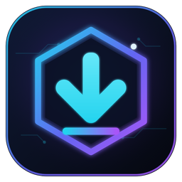

<h1 align="center">NexGrab</h1>

<b>Paste. Grab. Done.</b> - free video & audio downloader for YouTube, Instagram, Facebook, TikTok, X and 1000+ sites. 
No login. No history. Website + Android + Windows.

## What is in this repo

| Folder | What |
|---|---|
| `index.html`, `app.js`, `style.css`, `assets/` | The website (GitHub Pages, served from the repo root). Paste a link -> pick quality -> download. Nothing is stored. |
| `server/` | Tiny download server the website talks to (FastAPI + yt-dlp + ffmpeg). No database, no logs of links; files are deleted right after download. |
| `apps/android/` | Android app (Flutter + yt-dlp engine, Tor support). |
| `apps/pc/` | Windows app (Python + customtkinter + yt-dlp). |
| `apps/` (root files) | Local builders for Windows PCs (`NexGrab Builder.bat`, `BUILD_ALL.bat`). |
| `.github/workflows/` | `Build apps` = builds APK + EXE and publishes a Release. |

## Publish a new app version
GitHub -> **Actions** -> **Build apps** -> **Run workflow** -> type the version (e.g. `3.2.1`).
About 15-20 minutes later the Release appears and the website's download buttons point to it automatically
(`releases/latest/download/NexGrab.apk`, `NexGrab_32bit.apk`, `NexGrab_Windows.zip`).

Secret `ANDROID_DEBUG_KEYSTORE_B64` (Settings -> Secrets -> Actions) keeps the same signing key for every
release, so a new APK installs over the old one.

## Website settings
`config.js` - `API` (download server URL) and `REPO` (this repo, for the app download links).

## Download server
Deploy `server/` anywhere that runs Docker (Render blueprint: `render.yaml`, free plan works).

| Env var | Default | Meaning |
|---|---|---|
| `MAX_JOBS` | 2 | parallel downloads |
| `MAX_PER_IP` | 1 | active downloads per visitor |
| `MAX_FILESIZE_MB` | 1500 | biggest file the website allows |
| `MAX_DURATION_MIN` | 180 | longest video |
| `JOB_TTL_SEC` | 900 | unfetched files are deleted after this |
| `ALLOWED_ORIGINS` | `*` | CORS, e.g. `https://nexgrab.github.io` |
| `PROXY` | - | optional outgoing proxy |
| `COOKIES_FILE` | - | optional cookies.txt (helps YouTube on servers) |

Run locally: `cd server && pip install -r requirements.txt && uvicorn app:app --port 8000`

---
Only download content you have the right to download. NexGrab is not affiliated with any website. · by WSNex
